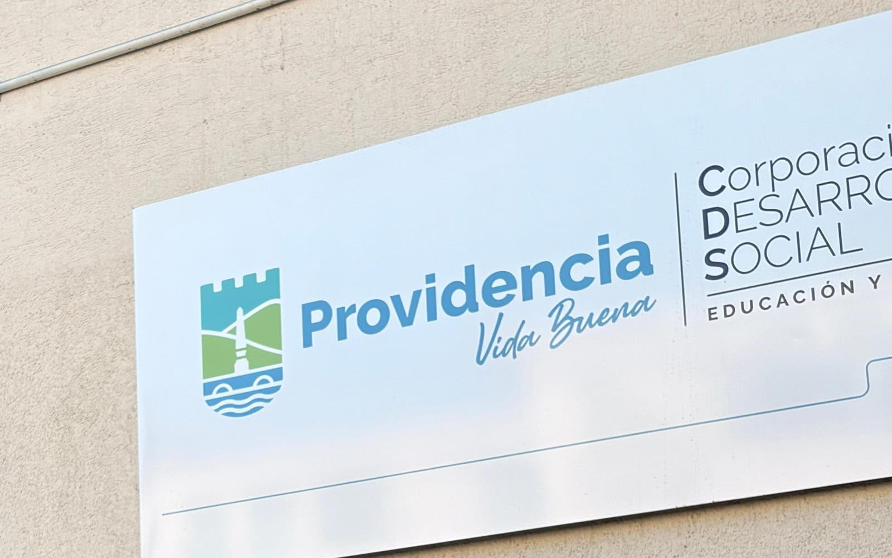
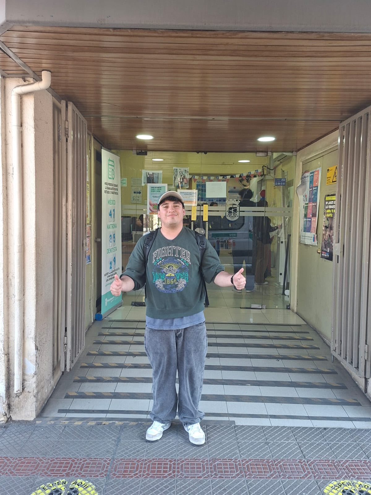

# Sesión 3 — Visita a terreno

📅 **Fecha:** 05-09-2026
**Participantes:** Un integrante del equipo realizó la visita presencial y documentó la evidencia fotográfica (ver fotografía); el resto del equipo participó del análisis posterior de lo recogido.
**Lugar o modalidad:** Providencia — edificio de la Corporación de Desarrollo Social (CDS) de la Municipalidad de Providencia ("Providencia, Vida Buena")

## 🎯 Objetivo de la sesión

Realizar una primera visita a terreno para observar en el lugar cómo funciona el sistema de atención y de espera, y recoger evidencia fotográfica del problema de gestión de horas.

## 🔎 Evidencia recogida

Fotografía del letrero institucional en la fachada del edificio visitado:

Fotografía de un integrante del equipo en el acceso del edificio, junto a un tablero de números de atención en espera:

- **Médico:** 47
- **Matrona:** 35
- **Dentista:** 29
- El tablero incluye además un aviso, reconstruido por contexto a partir del texto parcialmente ilegible en la foto: *"Horas perdidas durante la semana anterior por retiros e inasistencias. Si no puede asistir a su hora, avise oportunamente."*

## 💭 Lectura de la visita

El tablero de números en espera es evidencia directa de la carga de atención diaria (decenas de personas en espera solo esa mañana) y respalda el problema levantado en la Sesión 2: la gestión de inasistencias y reagendamientos impacta directamente los tiempos de espera y el uso de los cupos disponibles.

## ➡️ Próximos pasos

- [ ] Si es posible, conversar con personal administrativo en una próxima visita para responder las preguntas pendientes de la Sesión 2.
