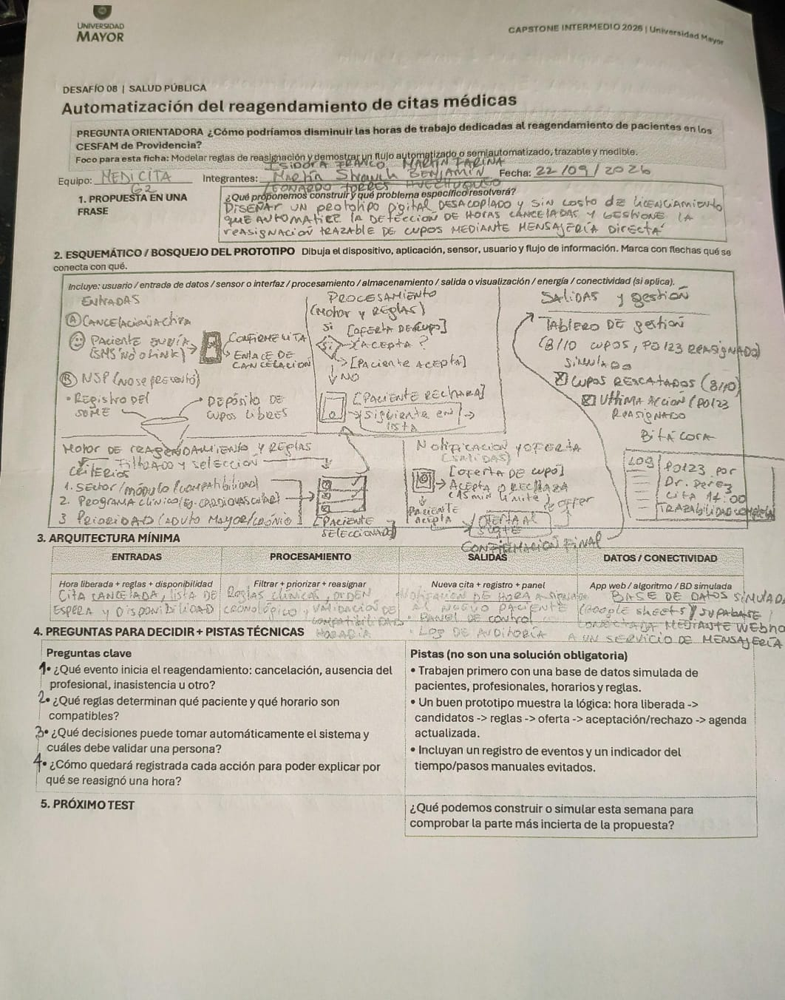
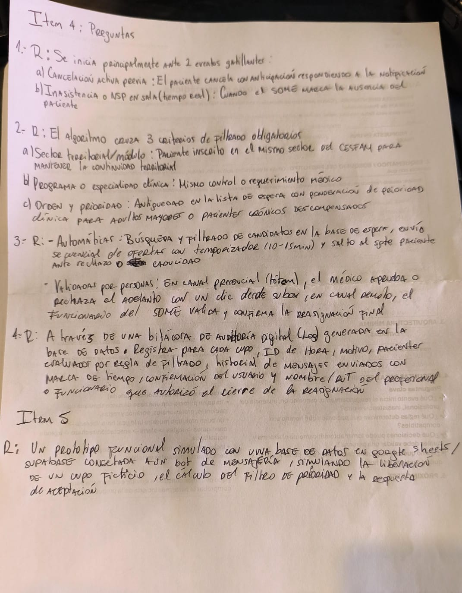

# Sesión 5 — Diseño del prototipo (ficha técnica)

📅 **Fecha:** 22-09-2026
**Participantes:** Isidora Franco, Martín Fariña, Martín Strauch, Benjamín Huechuqueo, Leonardo Torres
**Lugar o modalidad:** ⚠️ *por confirmar*

## 🎯 Objetivo de la sesión

Diseñar el prototipo técnico de MediCita a partir de la ficha oficial del Desafío 08: una propuesta en una frase, el esquemático del flujo, la arquitectura mínima, y responder las preguntas clave planteadas por el curso para decidir el alcance del prototipo.

## 📋 Ficha completada — Desafío 08



**Equipo:** MEDICITA G2
**Integrantes:** Isidora Franco, Martín Fariña, Martín Strauch, Benjamín Huechuqueo, Leonardo Torres
**Fecha:** 22-09-2026

### 1. Propuesta en una frase

> Diseñar un prototipo digital desacoplado y sin costo de licenciamiento que automatice la detección de horas canceladas y gestione la reasignación trazable de cupos mediante mensajería directa.

### 2. Esquemático / bosquejo del prototipo

**Entradas**
- (A) Cancelación anticipada: el paciente envía SMS/WhatsApp/enlace de cancelación.
- (B) NSP (no se presentó): registro del SOME.

**Procesamiento (motor y reglas)**

```
Confirmación de cita
   ↓
Enlace de cancelación
   ↓
Motor de reasignación y reglas
   ↓
Filtrado y selección según:
  1. Sector / módulo (compatibilidad territorial)
  2. Programa clínico / especialidad
  3. Prioridad (adulto mayor / paciente crónico)
   ↓
Paciente seleccionado
   ↓
¿Oferta de cupo? → ¿Acepta?
  ├─ No → pasa al siguiente paciente de la lista
  └─ Sí → confirmación final
```

**Salidas y gestión**
- Tablero de gestión simulado (ej. 8/10 cupos, P0123 reasignado).
- Indicador de cupos rescatados (8/10).
- Registro de la última acción (ej. "P0123 reasignado").
- Bitácora / log con trazabilidad verificable (ej. "P0123 por Dr. Pérez, cita 14:00").

### 3. Arquitectura mínima

| Entradas | Procesamiento | Salidas | Datos / Conectividad |
|---|---|---|---|
| Cita cancelada, lista de espera y disponibilidad (hora liberada + reglas + disponibilidad) | Filtrar + priorizar + reasignar (reglas clínicas, orden cronológico, validación de compatibilidad y horario) | Nueva cita + registro + panel (notificación de hora asignada al nuevo paciente, panel de control, log de auditoría) | App web / algoritmo / BD simulada: base de datos simulada en Google Sheets y/o Supabase, conectada mediante webhook de mensajería |

### 4. Preguntas para decidir + pistas técnicas (y nuestras respuestas)



**Pregunta 1 — ¿Qué evento inicia el reagendamiento: cancelación, ausencia del profesional, inasistencia u otro?**

> Se inicia principalmente ante 2 eventos gatillantes:
> a) Cancelación activa previa: el paciente cancela con anticipación respondiendo a la notificación.
> b) Inasistencia o NSP en sala (tiempo real): cuando el SOME marca la ausencia del paciente.

**Pregunta 2 — ¿Qué reglas determinan qué paciente y qué horario son compatibles?**

> El algoritmo cruza 3 criterios de filtrado obligatorios:
> a) Sector territorial / módulo: el paciente debe estar inscrito en el mismo sector del CESFAM, para mantener la continuidad territorial.
> b) Programa o especialidad clínica: mismo control o requerimiento médico.
> c) Orden y prioridad: antigüedad en la lista de espera, con ponderación de prioridad clínica para adultos mayores o pacientes crónicos descompensados.

**Pregunta 3 — ¿Qué decisiones puede tomar automáticamente el sistema y cuáles debe validar una persona?**

> - **Automáticas:** búsqueda y filtrado de candidatos en la base de espera, envío secuencial de ofertas con temporizador (10-15 min) y salto al siguiente paciente ante rechazo o caducidad.
> - **Validadas por personas:** en canal presencial (tótem), el médico aprueba o rechaza el adelanto con un clic desde su box; en canal remoto, el funcionario del SOME valida y confirma la reasignación final.

**Pregunta 4 — ¿Cómo quedará registrada cada acción para poder explicar por qué se reasignó una hora?**

> A través de una bitácora de auditoría digital (log) generada en la base de datos. Registra, para cada cupo: ID de hora, motivo, pacientes evaluados por regla de filtrado, historial de mensajes enviados con marca de tiempo, confirmación del usuario, y nombre/RUT del profesional o funcionario que autorizó el cierre de la reasignación.

**Pistas del curso (no son una solución obligatoria):**
- Trabajar primero con una base de datos simulada de pacientes, profesionales, horarios y reglas.
- Un buen prototipo muestra la lógica: hora liberada → candidatos → reglas → oferta → aceptación/rechazo → agenda actualizada.
- Incluir un registro de eventos y un indicador del tiempo/pasos manuales evitados.

### 5. Próximo test

**Pregunta del curso:** ¿Qué podemos construir o simular esta semana para comprobar la parte más incierta de la propuesta?

> Un prototipo funcional simulado con una base de datos en Google Sheets/Supabase, conectada a un bot de mensajería, simulando la liberación de un cupo ficticio, el cálculo del filtro de prioridad y la respuesta de aceptación.

## ➡️ Próximos pasos

- [ ] Completar lugar o modalidad de la sesión.
- [ ] Construir el prototipo simulado descrito en "Próximo test": base de datos simulada (Google Sheets/Supabase) + bot de mensajería.
